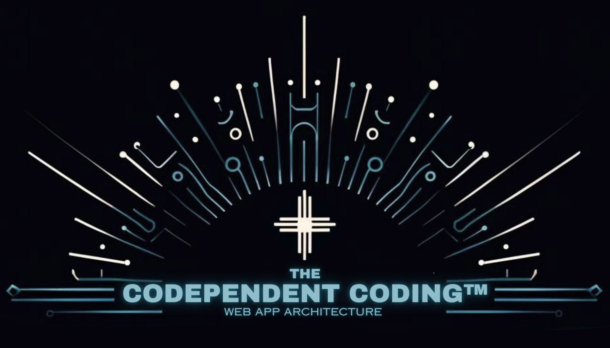
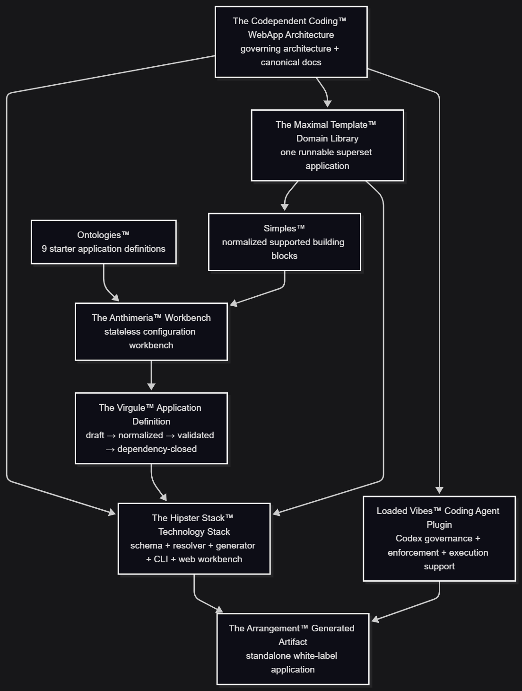

<div align="center">
  

  <br />
  <br />

  <h3>A SYSTEM FOR TURNING CODEBASES INTO CONTEXT AND CONTEXT INTO MEANING.</h3>

  <p>
    Who even still prompts?<br>
    Don't tell me you still write loops?<br>
    Loops are dead...<br>
    We build System Architecture!

        An invariant framework of contracts and gates
        that constrain the agent

  </p>

<p align="center">
  <a href="#what-this-is">What This Is</a>
  ·
  <a href="#quick-start">Quick Start</a>
  ·
  <a href="#the-mvp-loop">MVP Loop</a>
  ·
  <a href="#the-hipster-stack-technology-stack">Hipster Stack™</a>
  ·
  <a href="#the-maximal-template-domain-library">Maximal Template™</a>
  ·
  <a href="#the-loaded-vibes-plugin">Loaded Vibes™</a>
  ·
  <a href="#single-responsibility-principle">Architecture</a>
  ·
  <a href="#design-language">Design</a>
  ·
  <a href="#status">Status</a>
  ·
  <a href="#glossary">Glossary</a>
  ·
  <a href="#license">License</a>
</p>
  
  
  
  
  
  
  
  
  
  
  
  
  
  
  
  
  
  
  
  
  
  
  
</p>

</div>

</div>

# THE CODEPENDENT CODING™ WEBAPP ARCHITECTURE

> [!IMPORTANT]
>
> I got tired of remembering systems.
> So I started building systems
> that remember.

---

## What This Is

Codependent Coding is an internal software factory. One command turns the template into a new multi-tenant Next.js SaaS app with auth, tenancy and row-level security already wired, and a Claude Code plugin keeps the agent building inside the template's patterns from there.

| Part                         | Where                  | What it does                                                                                                    |
| ---------------------------- | ---------------------- | --------------------------------------------------------------------------------------------------------------- |
| **The Maximal Template™**    | `template/`            | One runnable superset app holding every supported module. Every generated app is cut from it.                   |
| **The Hipster Stack™ CLI**   | `packages/cli/`        | `hipster-stack`: makes apps from the template, adds modules, scaffolds vertical slices, checks an app's health. |
| **The Loaded Vibes™ Plugin** | `plugin/loaded-vibes/` | Claude Code skills, hooks and agents that turn an idea into docs, issues and slices, and lint every edit.       |
| **The doctrine**             | `.claude/contracts/`   | Every architecture rule has a `CC-*` ID in `validation.yaml` and is enforced by ESLint in `template/eslint/`.   |
| **The landing page**         | `app/`                 | The public brand page. Static, no data.                                                                         |

Read more in `context/docs/`: `PRD.md` (what and why), `Architecture.md` (layers and the classifier), `tech-requirements.md` (versions and scripts), `Design.md` and `AUTH.md`.

---

## Quick Start

You need Node 24, pnpm 12, Git and Claude Code. Commands are PowerShell 7; they run the same in bash.

### 1. Install the CLI

```powershell
git clone https://github.com/DigitalHerencia/CodependentCoding.git
cd CodependentCoding
pnpm install
pnpm --dir template install
pnpm setup        # once per machine, puts pnpm's global bin on PATH; open a new shell after
pnpm cli:link     # builds packages/cli and links `hipster-stack` globally
hipster-stack --help
```

On Windows, close VS Code before `pnpm install`, or it fails with "Access is denied" on `node_modules`.

If `pnpm cli:link` stops with `ERR_PNPM_GLOBAL_BIN_DIR_NOT_IN_PATH`, add the directory it names to PATH and run it again.

### 2. Make an app

```powershell
hipster-stack new ..\my-app                    # asks for a preset and modules
hipster-stack new ..\my-app --preset crm --yes # no prompts
```

The CLI prints the app's next steps: copy `.env.example` to `.env.local` and fill it in, then `pnpm db:init` and `pnpm dev`. The app lints and type-checks without it; `pnpm build` and `pnpm dev` need it.

Presets: `blank`, `crm`, `projects`, `support`, `marketing`, `invoicing`, `social`, `ai`, `portal`, `admin`. Add modules later with `hipster-stack add <module>` inside the app, and check its env, database, RLS and lint with `hipster-stack doctor`.

### 3. Install the plugin

The repo is its own plugin marketplace (`.claude-plugin/marketplace.json`, name `codependent-coding`). Inside Claude Code:

```text
/plugin marketplace add C:\path\to\CodependentCoding
/plugin install loaded-vibes@codependent-coding
```

`/plugin marketplace add DigitalHerencia/CodependentCoding` works too, without a clone. Restart Claude Code after installing; the skills then appear as `/loaded-vibes:<skill>`.

---

## The MVP Loop

Open the new app in Claude Code and run the skills in order:

| Step                    | What happens                                                                                          |
| ----------------------- | ----------------------------------------------------------------------------------------------------- |
| `/loaded-vibes:idea`    | A grill session turns your idea into the app's PRD, architecture, design docs and YAML contracts.     |
| `/loaded-vibes:plan`    | The PRD becomes issue files in `context/specs/issues/`, optionally synced to GitHub.                  |
| `/loaded-vibes:slice`   | One entity at a time: `hipster-stack slice <entity>` scaffolds it, the agent writes the domain logic. |
| `/loaded-vibes:check`   | Runs the app's validation, groups lint findings by `CC-*` rule ID, fixes causes, reruns until green.  |
| `/loaded-vibes:handoff` | Writes progress, decisions and handoff to `.claude/execution/` so the next session picks up cold.     |

`/loaded-vibes:classify` answers "where does this file go" at any point. `/loaded-vibes:ship` deploys an app to Vercel when you decide that app is worth deploying; nothing in the loop deploys on its own.

While you work, the plugin's hooks lint every file the agent edits and remind it to update `.claude/execution/` before it stops. They only run in a generated app (one with `hipster.json`); anywhere else they do nothing.

### Working on the factory itself

| Task                       | Command                        |
| -------------------------- | ------------------------------ |
| Validate the root repo     | `pnpm validate`                |
| Validate the template      | `pnpm --dir template validate` |
| Check rule IDs agree       | `pnpm doctrine:check`          |
| Regenerate plugin doctrine | `pnpm plugin:doctrine`         |

`pnpm doctrine:check` fails when a `CC-*` ID used in `template/eslint/`, the plugin, the docs or this README is missing from `validation.yaml`, or when a contract rule points at an ESLint rule that does not exist. Run `pnpm plugin:doctrine` after changing the classifier (Architecture.md §3.3) or `validation.yaml`. Root and template are separate pnpm projects.

---

## THE HIPSTER STACK™ TECHNOLOGY STACK

    Constituted Not Composed.

### WHEN EPISTEMOLOGIES FAIL<br> THE STACK STILL GOVERNS

Finally, a technology stack with provenance that won't rust.
Nothing to borrow.
We've already checked.

#### The Technology Stack

- **Next.js**: eliminated a category of bullshit
- **React**: functions that return functions
- **TypeScript**: court-appointed supervisor
- **JavaScript**: historical inevitability
- **Tailwind**: tolerated because CSS exists
- **PostCSS**: fuck PostCSS
- **ShadCN UI**: pretty cool
- **Zod**: doesn't care about your interface
- **Prisma**: database operations without raw SQL everywhere
- **Postgres**: cool
- **JSONB**: also cool
- **Neon**: Serverless Postgres without the bullshit
- **Clerk**: stay in your lane and we're good
- **Stripe**: same
- **Redis**: no longer responsible for every known problem
- **Recharts**: recharted
- **ESLint**: go ESLint yourself then please run before commit
- **Prettier**: stop touching my shit also CI requires it
- **YAML**: disgusting but operational
- **pnpm**: dependency management slightly less deranged
- **Node**: respect
- **Deno**: tell Ryan we said hi
- **Bun**: fuck Bun
- **Vercel**: pretentious but useful
- **GitHub**: good enough
- **VS Code**: good-ish
- **NeoVim**: fuck NeoVim btw
- **Arch**: fuck Arch btw
- **PowerShell**: where the work happens
- **Redux Toolkit**: absolutely fucking not
- **Codex**: pretty fucking cool
- **ChatGPT**: management denies allegations of involvement

---

## The Maximal Template™ Domain Library

> [!IMPORTANT]
> Introducing The Maximal Template™
> Maximum SaaS Per Token.
>
> Because productivity is dead.
> Long live product.
>
> Not the boring, spreadsheet-shaped “product.”
> We mean the good product. The dangerous product.
> The don’t-ask-what’s-in-it, just ship it product.
>
> Ship less code.
> Move more product.

**The Maximal Template** is a runnable, standalone, white-label superset application containing all supported implementation material that the generator can legally retain, remove, or transform.

#### Logic and server-operation

- fetchers
- actions
- workflows
- transaction helpers
- Prisma selects
- DTO mappers
- schemas
- types
- auth
- authz
- cache
- integration helpers
- webhook handlers
- constants
- utilities
- Prisma schema/domain models
- environment/config requirements

#### Public and product

- Landing page
- Pricing page
- Features / product-tour page
- Contact / demo-request page
- FAQ page
- Terms / privacy surfaces where required

#### Authentication and onboarding

- Sign in
- Sign up
- Workspace setup / onboarding
- Team invitation surfaces

#### Core application

- Main dashboard / overview
- Data list / table
- Detail / single-record view
- Kanban board
- Calendar / timeline
- Analytics / reports dashboard

#### Settings and management

- User profile settings
- Team / members
- Billing / subscriptions
- API / integrations settings

#### Utility and error

- 404
- 500 / fatal server error
- access denied / unauthorized
- maintenance / empty state where supported

#### Domain application surfaces

- CRM pipeline, contact directory, account profile, revenue analytics
- Project overview, backlog, timeline/Gantt, my tasks
- Support inbox, ticket workspace, knowledge base, SLA analytics
- Marketing campaign studio, audience manager, attribution analytics
- Invoice creator, invoice directory, expense upload/OCR
- Social calendar, composer, media library
- AI generation workspace, prompt playground, usage dashboard
- B2B shared dashboard, document vault, billing hub
- Admin record inspector, bulk user operations, audit logs

---

## THE LOADED VIBES™ PLUGIN

**Loaded Vibes** is the architecture-aware Claude Code plugin for apps made by `hipster-stack`.

Its purpose is not to invent architecture. Its purpose is to make the architecture operational for coding agents.

It ships seven skills (`idea`, `plan`, `slice`, `classify`, `check`, `ship`, `handoff`), two hooks (lint on edit, execution-state check on stop) and two agents (`reviewer`, `verifier`). It helps an agent:

1. inspect the actual repository and local instructions;
2. classify requested work into the correct layers;
3. preserve route/feature/presentation and server-operation boundaries;
4. respect auth/authz/tenancy/provider/security invariants;
5. plan bounded work and implement without architecture drift;
6. validate architecture boundaries and run proportional checks;
7. produce evidence-backed handoff.

`plugin/loaded-vibes/references/doctrine.md` is generated by `pnpm plugin:doctrine`.

---

# System Identity and Product Topology

<div align="center">
  

</div>

---

## Single Responsibility Principle

    A module should have one reason to change
    because it owns one architectural responsibility

Correct architecture-specific examples:

| Concern                                  | Canonical home                    | Core rule                                                                                                     |
| ---------------------------------------- | --------------------------------- | ------------------------------------------------------------------------------------------------------------- |
| URL / page route                         | `app/`                            | Own routing and route-level HTTP concerns only.                                                               |
| Provider webhook route                   | `app/api/{provider}/.../route.ts` | Own raw request lifecycle and provider acknowledgement.                                                       |
| Application orchestration                | `features/`                       | Combine application helpers and presentation.                                                                 |
| Browser-only orchestration               | `*.client.tsx`                    | Create only when browser state/interaction requires it.                                                       |
| Reusable UI composition                  | `components/blocks/`              | Pure presentation composed from primitives.                                                                   |
| Navigation                               | `components/nav/`                 | Reusable structural presentation.                                                                             |
| Page/application shell                   | `components/shells/`              | Reusable structural frame.                                                                                    |
| Raw UI primitive                         | `components/ui/`                  | Lowest-level presentation primitive.                                                                          |
| Persisted read                           | `lib/fetchers/`                   | Read-only.                                                                                                    |
| Ordinary persisted CRUD write            | `lib/actions/`                    | Mutation boundary; authn/authz/validation/scoping required as applicable.                                     |
| Prisma runtime/client                    | `lib/db/`                         | Database runtime infrastructure.                                                                              |
| Prisma select                            | `lib/db/selects/`                 | Precise persisted projection.                                                                                 |
| DTO mapper                               | `lib/db/dto/`                     | Persisted/domain shape → transport-safe application shape.                                                    |
| Atomic DB transaction                    | `lib/db/transactions/`            | Preserve multi-write database invariants.                                                                     |
| Authentication                           | `lib/auth/`                       | Clerk and app-facing identity/session helpers.                                                                |
| Authorization                            | `lib/authz/`                      | RBAC, ABAC, resource policy, tenant/resource decisions.                                                       |
| Provider behavior                        | `lib/integrations/{provider}/`    | Provider-specific client/mechanics/adapters.                                                                  |
| Reusable application-logic orchestration | `lib/workflows/{domain}/`         | Constitute named behavior from existing server operations and helpers; do not wrap trivial CRUD ceremonially. |
| Cache                                    | `lib/cache/`                      | Tags, lifetimes, invalidation and related infrastructure.                                                     |
| Constant                                 | `lib/constants/`                  | Stable shared constants.                                                                                      |
| Generic utility                          | `lib/utils/`                      | True generic utility only.                                                                                    |
| Prisma schema/migrations/seed            | `prisma/`                         | Prisma-owned lifecycle.                                                                                       |
| Runtime schemas                          | `schemas/`                        | Shared Zod validation at trust boundaries.                                                                    |
| Shared TS contracts                      | `types/`                          | Useful shared compile-time contracts.                                                                         |

## PR's

Tonight, somewhere between discussions of domain boundaries, contribution strategy, public reputation, and the quiet mechanics of open-source trust, a simple truth emerged:

    PR does not merely mean Pull Request.
    It also means Public Relations.

Every commit is communication.
Every issue comment is character.
Every README is theatre.

Every pull request is a handshake, a calling card, and a small declaration of professional taste.

One does not simply submit code.
One presents oneself.

---

## Design Language

The architecture documentation and public product surfaces share a deliberate visual language.

### Visual character

The target is:

- dark-mode only;
- black / near-black canvases;
- white / off-white primary text;
- restrained cyan-teal signal color;
- dense technical composition;
- strong borders;
- square or minimally rounded geometry;
- mechanical rather than bouncy motion;
- controlled glow;
- bold condensed/industrial display type;
- mono technical body/code treatment;
- desert/circuit visual motifs.

Avoid:

- pastel rainbow palettes;
- candy-color UI;
- excessive rounded cards;
- toy-like iconography;
- generic startup-gradient aesthetics;
- decorative motion that competes with information.

#### Brand color

The current product web contract uses approximately:

```text
canvas: #05030b / black
text:   white / off-white
signal: #2f7a8d
```

The signal color is for underlines, status accents, restrained glow, circuit detail, and hierarchy—not for flooding the interface.

#### Typography

The current direction uses:

- Archivo Black bold condensed display treatment for headings and wordmarks
- Copperplate bold treatment for key branding and product names
- JetBrains Mono for technical body/UI text
- Fira Code-style for code text

Build-safe fallbacks are required. Typography should be treated as a role contract, not as a reason to ship fragile font dependencies.

#### Theme and Semantic Design Tokens

The visual system is configured through semantic tokens rather than arbitrary per-component colors.

The tokens live in the template's `globals.css` theme layer; `hipster-stack new --color <hex>` sets the brand signal for a new app.

Token dimensions include:

- palette
- background/foreground
- primary/secondary/accent
- destructive/success/warning/info
- border/input/ring
- chart colors
- signal/neon accents
- radius
- border width
- hard-shadow offset
- spacing/padding/margins within bounded supported scales
- motion/animation values
- heading/body/code font roles

---

## Status

> [!WARNING]
>
> I’ve seen things you language models wouldn’t believe…
> repos on fire off the main branch of GitHub…
> watched builds fail at the edge of the CI pipeline…
> all those moments… will be lost in time…
> like tokens outside the context window…
> time to deploy.

---

## License

Take this repo.
Clone it.
For it is open source.
Take this codebase.
Fork it.
For it is MIT.

    And as I walk through the
    valley of the shadow of deprecation.
    I shall fear no edits.
    In concurrency we promise.
    Async await.

---

## Glossary

| Term                   | Canonical meaning                                                                                                 |
| ---------------------- | ----------------------------------------------------------------------------------------------------------------- |
| **Route**              | URL/HTTP boundary.                                                                                                |
| **Feature**            | Application capability orchestration boundary.                                                                    |
| **Client Feature**     | Deliberate browser-only orchestration companion.                                                                  |
| **Block**              | Pure reusable UI composition.                                                                                     |
| **Primitive**          | Lowest-level UI component.                                                                                        |
| **Fetcher**            | Read-only persisted application data operation.                                                                   |
| **Action**             | Ordinary persisted CRUD mutation boundary.                                                                        |
| **Workflow**           | Named reusable orchestration boundary that constitutes application logic from existing server operations/helpers. |
| **Transaction Helper** | Atomic database persistence helper preserving multi-write invariants.                                             |
| **Select**             | Precise Prisma projection.                                                                                        |
| **DTO Mapper**         | Persistence/domain → transport-safe mapping function.                                                             |
| **Schema**             | Runtime boundary validation contract.                                                                             |
| **Authentication**     | Establishes verified identity/session.                                                                            |
| **Authorization**      | Decides permitted operation/resource/context.                                                                     |
| **Tenant**             | Architectural isolation concept.                                                                                  |
| **Organization**       | Canonical application-owned tenant entity in the default model.                                                   |
| **Membership**         | Contextual relationship connecting a User to an Organization and business authority.                              |
| **RLS**                | PostgreSQL row-level containment layer.                                                                           |
| **Integration**        | Provider-specific external-service mechanics.                                                                     |
| **Webhook**            | Provider HTTP request boundary and reconciliation lifecycle.                                                      |

---

Made in Nuevo Mexico | 2026 Ivan P. Roman | Digital Herencia
