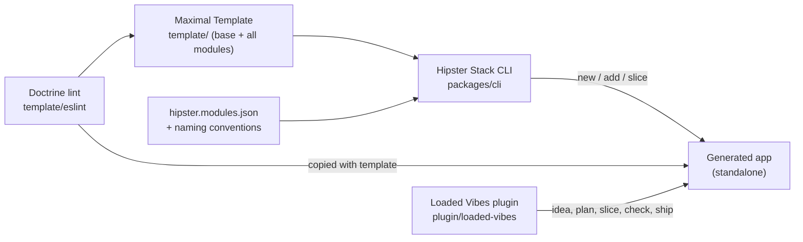
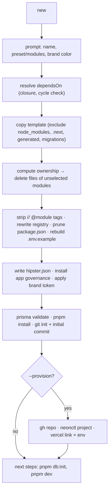

# Architecture

## 1. System map



**One sentence:** the CLI copies the Maximal Template, removes every file owned by an unselected module (ownership computed from names), and hands the result to Claude Code with the Loaded Vibes plugin, which drives it to MVP inside lint-enforced rails.

### 1.1 Why subtractive with computed ownership

The template is developed as **one real app**: one `pnpm dev`, one typecheck, one lint run. Modules are not stored separately; they are _defined_ by naming conventions plus a small manifest. The first build failed because ownership lived in a hand-maintained catalog that drifted. Here ownership is a pure function of the file path, so it cannot drift, and the orphan check proves every file has exactly one owner.

## 2. Governing sentence (unchanged doctrine)

> Routes own URL and HTTP boundaries. Features orchestrate application capabilities. Components render. Fetchers read persisted data. Actions own ordinary CRUD mutation boundaries. Schemas validate runtime input. Workflows constitute reusable application logic from server operations and helpers. Transactions preserve atomic database invariants. Authentication establishes identity. Authorization decides access. Integrations own provider mechanics. Webhooks own provider HTTP request lifecycles.

## 3. Template layer model

```text
URL ─► app/ (route) ─► features/ ─► components/blocks ─► components/ui
                          │
                          ├─► lib/fetchers   (reads)
                          ├─► lib/actions    (CRUD writes, "use server")
                          ├─► lib/workflows  (named application logic)
                          │      ├─► lib/db/transactions (atomic writes)
                          │      └─► lib/integrations/<provider>
                          ├─► lib/auth / lib/authz
                          └─► schemas/ · types/ · lib/cache · lib/constants · lib/utils
```

### 3.1 Responsibility map

| Concern                  | Home                                                                           | Rule                                                                        |
| ------------------------ | ------------------------------------------------------------------------------ | --------------------------------------------------------------------------- |
| URL / page               | `app/**/page.tsx`                                                              | Thin: Suspense + feature, or blocks for static public pages                 |
| Provider webhook         | `app/api/<provider>/webhooks/route.ts`                                         | Raw-body verify → idempotent persistence → ack                              |
| Capability orchestration | `features/<domain>/<domain><Thing>Feature.tsx`                                 | Server component; renders blocks                                            |
| Browser behavior         | `features/<domain>/<name>.client.tsx`                                          | `"use client"`; UI controls + actions only                                  |
| Form                     | `features/<domain>/<domain><Verb><Thing>Form.tsx`                              | React Hook Form + Zod + action; may use UI primitives                       |
| Loading                  | `features/<domain>/<domain><Thing>Skeleton.tsx`                                | Mirrors real layout; `ui/skeleton` only                                     |
| Domain presentation      | `components/templates/<domain><Thing>Template.tsx`                             | Pure; composed from blocks                                                  |
| Reusable composition     | `components/blocks/<kebab>.tsx`                                                | Pure presentation                                                           |
| Structure                | `components/nav`, `components/shells`                                          | Frames; Clerk UI widgets allowed                                            |
| Primitive                | `components/ui/<kebab>.tsx`                                                    | shadcn/BoldKit-derived                                                      |
| Read                     | `lib/fetchers/<domain>Fetchers.ts`                                             | `server-only`; auth → authz → scoped select → DTO                           |
| CRUD write               | `lib/actions/<domain>Actions.ts`                                               | `"use server"`; auth → authz → Zod → write/tx → invalidate → `ActionResult` |
| Application logic        | `lib/workflows/<domain>Workflows.ts` or `lib/workflows/<domain>/<verbNoun>.ts` | `server-only`; arranges operations; no Prisma client, no SDKs               |
| Atomic write             | `lib/db/transactions/<domain>-<verb>-<noun>.tx.ts`                             | DB-only; no network                                                         |
| DB runtime               | `lib/db/client.ts`, `rls.ts`, `tenant.ts`                                      | Prisma client, adapter, RLS context                                         |
| Projection               | `lib/db/selects/<domain>.selects.ts`                                           | Precise selects                                                             |
| Mapping                  | `lib/db/dto/<domain>.dto.ts`                                                   | Record → transport-safe DTO                                                 |
| Identity                 | `lib/auth/{clerk,auth,redirects,clerk-webhooks}.ts`                            | Clerk only here                                                             |
| Access                   | `lib/authz/{roles,permissions,resources,policies,attributes?}.ts`              | App-owned RBAC/ABAC                                                         |
| Provider                 | `lib/integrations/<provider>/<kebab>.ts`                                       | SDK only here                                                               |
| Cache                    | `lib/cache/{tags,life,invalidate}.ts`                                          | Semantics only                                                              |
| Module contribution      | `lib/modules/<id>.module.ts`, `registry.ts`                                    | Nav, dashboard widgets, permissions                                         |
| Env                      | `lib/env/<owner>.ts`                                                           | Zod-validated, `server-only`                                                |
| Validation               | `schemas/<domain>Schemas.ts`                                                   | Zod; client- and server-safe                                                |
| Shared types             | `types/<domain>Types.ts`                                                       | Compile-time contracts                                                      |
| Schema                   | `prisma/schema/<owner>.prisma`, `prisma/rls/<owner>.sql`, `prisma/seed.ts`     | Prisma lifecycle                                                            |

### 3.2 Exceptions (DEC-007)

1. Static public pages compose blocks directly (no feature).
2. Form features compose UI primitives directly and may declare `"use client"`.
3. Skeletons may import `components/ui/skeleton`.
4. `.client.tsx` companions may import interactive UI controls (button, input, label, select, checkbox, switch, textarea, toggle, date/time pickers, etc.).

### 3.3 Classifier (use before creating a file)

```text
Static public presentation?      app/(public) page + components/blocks
React Hook Form?                 features/<d>/<d><Verb><Thing>Form.tsx
Browser-only behavior?           features/<d>/<name>.client.tsx
Capability orchestration?        features/<d>/<d><Thing>Feature.tsx
Persisted read?                  lib/fetchers/<d>Fetchers.ts
Ordinary CRUD write?             lib/actions/<d>Actions.ts
Named application logic?         lib/workflows/<d>Workflows.ts
Multi-write atomicity?           lib/db/transactions/<d>-<verb>-<noun>.tx.ts
Prisma select / DTO?             lib/db/selects | lib/db/dto
Identity?                        lib/auth
Access decision?                 lib/authz
Provider SDK?                    lib/integrations/<provider>
Webhook HTTP lifecycle?          app/api/<provider>/webhooks/route.ts
Runtime validation?              schemas/<d>Schemas.ts
Shared type?                     types/<d>Types.ts
Cache tag / lifetime?            lib/cache
Constant / pure util?            lib/constants | lib/utils
None of the above?               Stop. Do not invent a layer (CC-NAME-002).
```

## 4. Doctrine enforcement

Doctrine is code. `template/eslint/doctrine-map.mjs` is the machine table (layers, import categories, boundaries, naming); `template/eslint/codependent-plugin.mjs` is the mechanics; `.claude/contracts/validation.yaml` is the contract. Every finding prints its rule ID.

| ID               | Rule                                                                                       | Enforcement                          |
| ---------------- | ------------------------------------------------------------------------------------------ | ------------------------------------ |
| CC-ROUTE-001     | Routes never import DB, fetchers, actions, workflows, integrations, SDKs, or UI primitives | `codependent/layer-boundaries`       |
| CC-ROUTE-002     | `proxy.ts` only gates routes                                                               | layer-boundaries                     |
| CC-HOOK-001      | Route handlers: no Prisma, SDKs, Clerk server, presentation                                | layer-boundaries                     |
| CC-FEAT-001      | Normal features: no DB, transactions, integrations, SDKs, UI primitives, RHF               | layer-boundaries                     |
| CC-FEAT-002      | Forms: no DB, fetchers, workflows, integrations                                            | layer-boundaries                     |
| CC-FEAT-003      | Skeletons: `ui/skeleton` + blocks only                                                     | layer-boundaries                     |
| CC-FEAT-004      | Client companions: controls + actions; no server reads                                     | layer-boundaries                     |
| CC-BLOCK-001     | Blocks/templates are pure presentation                                                     | layer-boundaries                     |
| CC-BLOCK-002     | Nav/shells pure presentation (+ Clerk UI)                                                  | layer-boundaries                     |
| CC-UI-001 / 002  | Primitives and hooks stay presentation/browser-side                                        | layer-boundaries                     |
| CC-READ-001      | Fetchers: no actions, workflows, integrations, transactions                                | layer-boundaries                     |
| CC-READ-002      | Fetchers never call Prisma write methods                                                   | `codependent/no-fetcher-writes`      |
| CC-WRITE-001     | Actions: no integrations or SDKs                                                           | layer-boundaries                     |
| CC-WRITE-002     | Actions start with `"use server"`                                                          | `codependent/use-server-actions`     |
| CC-FLOW-001      | Workflows: no Prisma client, no SDKs                                                       | layer-boundaries                     |
| CC-TX-001        | Transactions: DB only                                                                      | layer-boundaries                     |
| CC-TX-002        | No `fetch()` in transactions                                                               | `codependent/no-transaction-network` |
| CC-DB-001        | `lib/db` does not reach up into app layers                                                 | layer-boundaries                     |
| CC-DB-002        | No unsafe raw SQL; tagged raw SQL only in `lib/db`                                         | `codependent/no-raw-sql`             |
| CC-AUTH-001      | Authentication never decides access                                                        | layer-boundaries                     |
| CC-AUTHZ-001     | Authorization never reads Clerk server state                                               | layer-boundaries                     |
| CC-INT-001       | Integrations never persist                                                                 | layer-boundaries                     |
| CC-CACHE-001     | Cache helpers hold semantics only                                                          | layer-boundaries                     |
| CC-PURE-001      | Constants/utils/types are dependency-free                                                  | layer-boundaries                     |
| CC-SCHEMA-001    | Schemas are pure                                                                           | layer-boundaries                     |
| CC-SRV-001       | Server modules import `server-only` (auto-fix)                                             | `codependent/require-server-only`    |
| CC-CLIENT-001    | `"use client"` placement                                                                   | `codependent/use-client-placement`   |
| CC-NAME-001      | Directory naming conventions                                                               | `codependent/filename-convention`    |
| CC-NAME-002      | No `services/`, `managers/`, `helpers/`...                                                 | `codependent/no-generic-names`       |
| CC-STYLE-001     | Named exports only (framework files excepted)                                              | `codependent/no-default-export`      |
| CC-STYLE-002     | `@/` alias, no parent-relative imports (auto-fix)                                          | `codependent/no-parent-imports`      |
| CC-MOD-001       | A module imports another module only if declared in `dependsOn`                            | `codependent/module-boundaries`      |
| CC-MOD-002       | Base never imports module-owned files (registry excepted)                                  | `codependent/module-boundaries`      |
| CC-MOD-003       | Every file has exactly one owner                                                           | `pnpm check:ownership`               |
| CC-FMT-001 / 002 | Prettier formatting; Tailwind class order                                                  | Prettier + plugin                    |
| CC-TS-001        | `strict`, `noUncheckedIndexedAccess`, `exactOptionalPropertyTypes`                         | tsconfig                             |

Review-only rules (not mechanizable, checked by the `reviewer` agent): actions validate with Zod before writing; tenant scope lives in the query predicate; consequential decisions never read stale cache; webhooks reconcile current provider truth.

## 5. Module system

### 5.1 Manifest — `template/hipster.modules.json`

```jsonc
{
  "$schema": "./hipster.modules.schema.json",
  "base": { "owns": ["**"], "env": [] }, // fallback owner; env as below (DATABASE_URL, Clerk)
  "modules": [
    {
      "id": "crm",
      "kind": "domain", // domain | addon
      "label": "CRM / Pipeline",
      "description": "Contacts, accounts, leads, pipeline, analytics",
      "dependsOn": ["email"],
      "owns": [], // extra globs beyond conventions
      "packages": [], // npm deps only this module needs
      "env": [], // { name, required, scope: server|public, description }
    },
    {
      "id": "billing",
      "kind": "addon",
      "label": "Billing (Stripe)",
      "dependsOn": [],
      "owns": ["lib/integrations/stripe/**", "app/api/stripe/**"],
      "packages": ["stripe"],
      "env": [
        { "name": "STRIPE_SECRET_KEY", "required": true, "scope": "server" },
      ],
    },
  ],
  "presets": {
    "blank": [],
    "crm": ["crm"],
    "projects": ["projects", "uploads"],
    "support": ["support", "email"],
    "marketing": ["marketing", "email"],
    "invoicing": ["invoicing", "billing", "uploads"],
    "social": ["social", "media", "uploads"],
    "ai": ["ai", "inference", "billing", "ratelimit"],
    "portal": ["portal", "invoicing", "uploads", "billing"],
    "admin": ["admin"],
  },
}
```

The manifest holds **build-time** facts only. Runtime contributions live in `lib/modules/<id>.module.ts`. No field appears in both.

### 5.2 Ownership conventions (computed)

A file belongs to module `<id>` when, in order:

1. It matches a module's explicit `owns` glob; else
2. Any path segment equals `<id>` (`features/crm/`, `app/(tenant)/crm/`, `lib/workflows/crm/`, `tests/crm/`); else
3. The basename starts with `<id>` followed by an uppercase letter, `.` or `-` (`crmFetchers.ts`, `crm.selects.ts`, `crm.dto.ts`, `crm-update-deal-stage.tx.ts`, `crmContactsTemplate.tsx`, `crm.prisma`, `crm.sql`, `crm.module.ts`); else
4. It belongs to **base**.

Two modules matching the same file is an error (CC-MOD-003). Module IDs must not collide with base vocabulary (`organization`, `membership`, `onboarding`, `settings`, `dashboard`, `identity`, `auth`, `webhook`, `audit`).

### 5.3 Cross-module references

- **TypeScript:** base reaches module code only via `lib/modules/registry.ts`:

  ```ts
  // generated by hipster-stack — do not edit by hand
  import { crmModule } from "@/lib/modules/crm.module";
  import { projectsModule } from "@/lib/modules/projects.module";
  export const installedModules = [crmModule, projectsModule] as const;
  ```

  Shells, sidebar, dashboard, and the authz permission catalog read `installedModules`.

- **Prisma:** relation fields on base models carry a tag; the CLI deletes tagged lines for removed modules:

  ```prisma
  model Organization {
    id        String   @id @default(cuid())
    contacts  Contact[] // @module crm
    projects  Project[] // @module projects
  }
  ```

- **Module → module:** only when declared in `dependsOn` (CC-MOD-001).

### 5.4 Module runtime definition

```ts
// lib/modules/crm.module.ts
import type { ModuleDefinition } from "@/types/moduleTypes";

export const crmModule = {
  id: "crm",
  nav: [{ label: "Pipeline", href: "/crm/pipeline", icon: "kanban" }],
  dashboard: [{ id: "crm-pipeline-value", title: "Pipeline value" }],
  permissions: {
    resources: ["crm.contact", "crm.account", "crm.deal"],
    // OWNER and ADMIN hold everything; an action applies to every resource above.
    grants: { MEMBER: ["read", "create", "update", "delete"] },
  },
} satisfies ModuleDefinition;
```

## 6. Hipster Stack CLI



| Command                                                                 | Purpose                                                                        |
| ----------------------------------------------------------------------- | ------------------------------------------------------------------------------ |
| `new <dir> [--preset p] [--modules a,b] [--color #hex] [--tenancy multi | single] [--access abac                                                         | rbac] [--database-url url] [--provision] [--yes]` | Generate an app |
| `add <module>`                                                          | Copy a module's owned files from the template into an app, re-tag, re-register |
| `slice <entity> --module <id> --fields "<dsl>"`                         | Full vertical slice from golden templates                                      |
| `doctor`                                                                | Env, DB, migrations, lint, ownership                                           |
| `compose <dir> --all\|--preset\|--modules`                              | Non-interactive (CI)                                                           |

`hipster.json` (generated app):

```json
{
  "template": {
    "commit": "<sha>",
    "path": "D:/TheCodependentCodingWebAppArchitecture/template"
  },
  "cli": "1.0.0",
  "createdAt": "2026-10-22T00:00:00Z",
  "modules": ["projects", "uploads"],
  "color": "#2f7a8d"
}
```

## 7. Loaded Vibes plugin

```text
plugin/loaded-vibes/
├── .claude-plugin/plugin.json
├── skills/{idea,plan,slice,classify,check,ship,handoff}/SKILL.md
├── agents/{reviewer,verifier}.md
├── hooks/hooks.json            PostToolUse lint · Stop execution-state guard
├── scripts/*.mjs               hook implementations
└── references/doctrine.md      condensed classifier + CC rule table
```

The MVP loop inside a generated app:

```text
hipster-stack new → /idea (grill → PRD, tech, architecture, design, auth → 3 YAML)
→ /plan (issues) → /slice ×N (CLI scaffold + domain logic) → /check → /ship → /handoff
```

## 8. Governance layers

| Layer       | Location                                | Audience | Authority                                    |
| ----------- | --------------------------------------- | -------- | -------------------------------------------- |
| Intent      | `context/docs/*.md`                     | Human    | Highest for meaning                          |
| Contracts   | `.claude/contracts/*.yaml`              | Machine  | Compiled from intent; must not contradict it |
| Enforcement | `template/eslint/*`, Prettier, tsconfig | Machine  | Executable form of validation.yaml           |
| Work        | `context/specs/issues/*.md` → GitHub    | Both     | What to do next                              |
| Execution   | `.claude/execution/*.json`              | Agent    | What happened; never architecture            |
| Reference   | `context/doctrine/`                     | Human    | Explanatory only                             |

Conflict rule: intent wins; fix the contract, then the enforcement, in the same PR.

## 9. Source-of-truth allocation

| Fact                              | Authority                                             |
| --------------------------------- | ----------------------------------------------------- |
| Module ownership                  | File path + `hipster.modules.json` (computed)         |
| Installed modules (generated app) | `hipster.json` + `lib/modules/registry.ts`            |
| Doctrine rules                    | `validation.yaml` ⇄ `doctrine-map.mjs` (sync-checked) |
| Identity                          | Clerk                                                 |
| Users, orgs, memberships, roles   | Application Postgres                                  |
| Payments                          | Stripe (interpreted by app)                           |
| Work status                       | GitHub issues/Project                                 |
| Completion evidence               | Executed commands recorded in `progress.json`         |

## Appendix A. Golden slice: `projects`

`projects` is the reference module that scaffolds copy (CC-027). Every file opens with a one-line `Why:` comment naming its layer's job. Reads follow AUTH.md §5.3: fetchers run in `withAuthenticatedRead`, check `projects.project:read` (or `projects.task:read`), put `organizationId` in every predicate and return `null` when a row is absent, so features call `notFound()`. Writes go through `lib/actions/projectsActions.ts`: authenticate, open the tenant transaction (RLS context set), check `projects.project:create`/`:update`, parse with the shared Zod schema, write, then invalidate the affected routes and return an `ActionResult` (AUTH.md §8). A versioned update that matches no row is `CONFLICT` when the row exists in the organization and `NOT_FOUND` otherwise.

The list below is generated; rerun `node scripts/slice-files.mjs projects --write` from `template/` after adding or moving a file.

<!-- slice:projects:start -->

**Routes**

- `app/(tenant)/my-tasks/page.tsx`
- `app/(tenant)/projects/[projectId]/edit/page.tsx`
- `app/(tenant)/projects/[projectId]/page.tsx`
- `app/(tenant)/projects/[projectId]/tasks/[taskId]/edit/page.tsx`
- `app/(tenant)/projects/[projectId]/tasks/[taskId]/page.tsx`
- `app/(tenant)/projects/[projectId]/tasks/new/page.tsx`
- `app/(tenant)/projects/[projectId]/tasks/page.tsx`
- `app/(tenant)/projects/[projectId]/timeline/page.tsx`
- `app/(tenant)/projects/new/page.tsx`
- `app/(tenant)/projects/page.tsx`

**Templates**

- `components/templates/projectsMyTasksTemplate.tsx`
- `components/templates/projectsProjectDetailTemplate.tsx`
- `components/templates/projectsTaskDetailTemplate.tsx`
- `components/templates/projectsTasksTemplate.tsx`
- `components/templates/projectsTemplate.tsx`
- `components/templates/projectsTimelineTemplate.tsx`

**Features**

- `features/projects/myTasksFeature.tsx`
- `features/projects/myTasksSkeleton.tsx`
- `features/projects/projectEditFeature.tsx`
- `features/projects/projectFeature.tsx`
- `features/projects/projectFormSkeleton.tsx`
- `features/projects/projectNewForm.tsx`
- `features/projects/projectSkeleton.tsx`
- `features/projects/projectsFeature.client.tsx`
- `features/projects/projectsFeature.tsx`
- `features/projects/projectsSkeleton.tsx`
- `features/projects/taskEditFeature.tsx`
- `features/projects/taskFeature.client.tsx`
- `features/projects/taskFeature.tsx`
- `features/projects/taskFormSkeleton.tsx`
- `features/projects/taskNewForm.tsx`
- `features/projects/taskSkeleton.tsx`
- `features/projects/tasksFeature.client.tsx`
- `features/projects/tasksFeature.tsx`
- `features/projects/tasksSkeleton.tsx`
- `features/projects/timelineFeature.tsx`
- `features/projects/timelineSkeleton.tsx`

**Actions**

- `lib/actions/projectsActions.ts`

**Fetchers**

- `lib/fetchers/projectsFetchers.ts`

**Workflows**

- `lib/workflows/projectsWorkflows.ts`

**Database (DTOs, selects, transactions)**

- `lib/db/dto/projects.dto.ts`
- `lib/db/selects/projects.selects.ts`
- `lib/db/transactions/projects-update-task-status.tx.ts`
- `lib/db/transactions/projects.tx.ts`

**Module definition**

- `lib/modules/projects.module.ts`

**Schemas**

- `schemas/projectsSchemas.ts`

**Types**

- `types/projectsTypes.ts`

**Prisma (models, RLS, seed)**

- `prisma/rls/projects.sql`
- `prisma/schema/projects.prisma`
- `prisma/seeds/projects.ts`

**Tests**

- `tests/projects/projectsActions.test.ts`
- `tests/projects/projectsWorkflows.test.ts`

<!-- slice:projects:end -->
